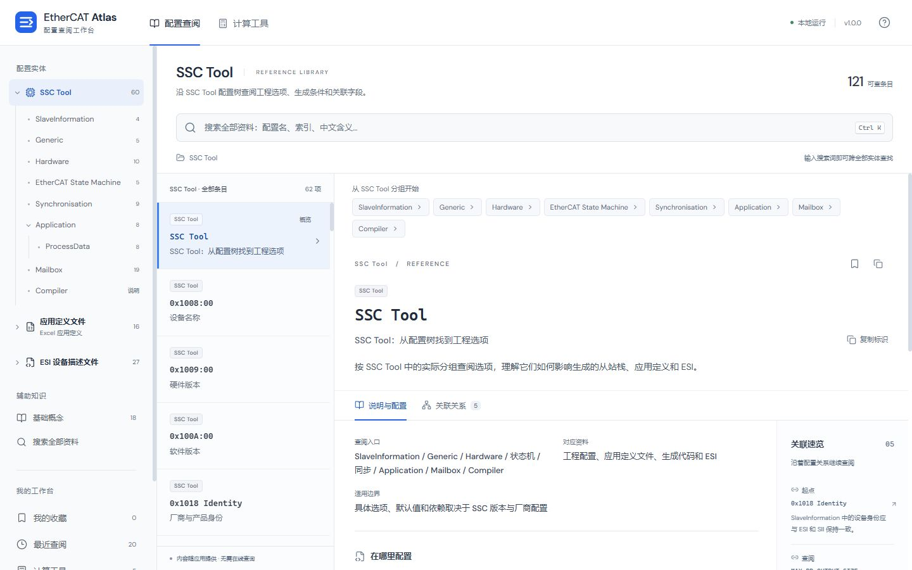
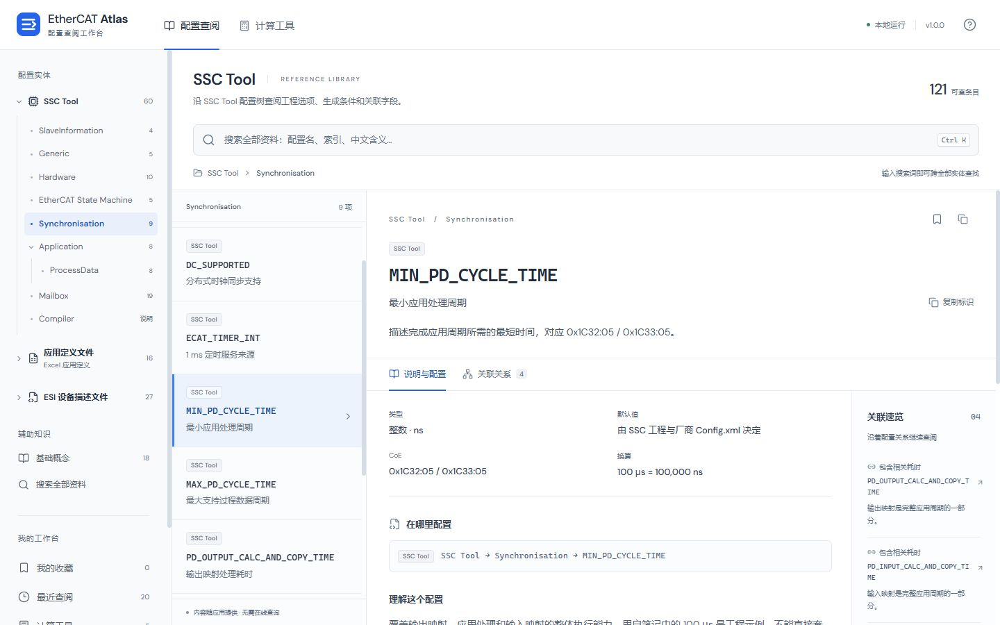
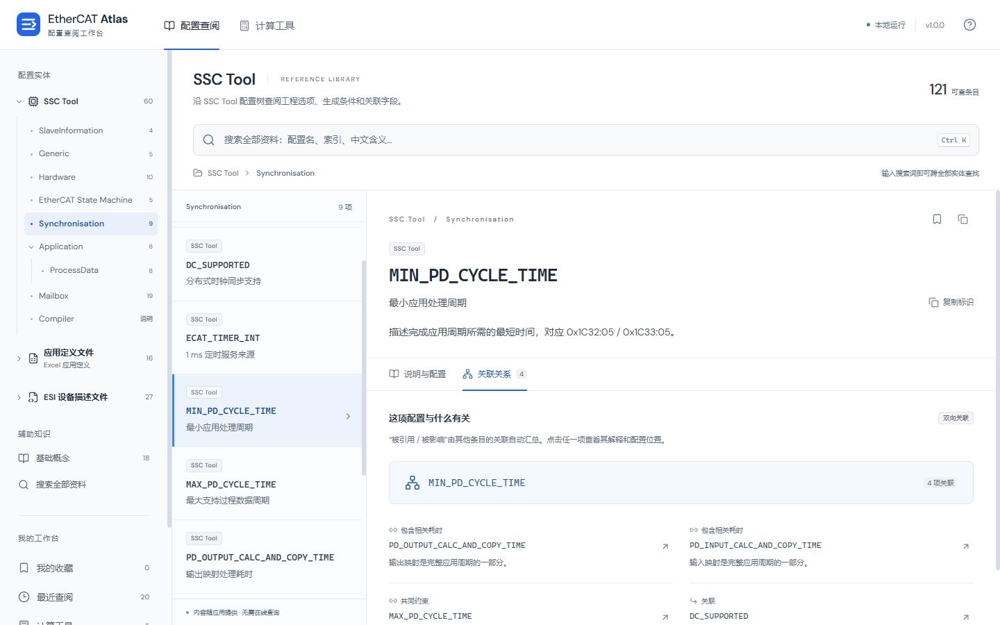
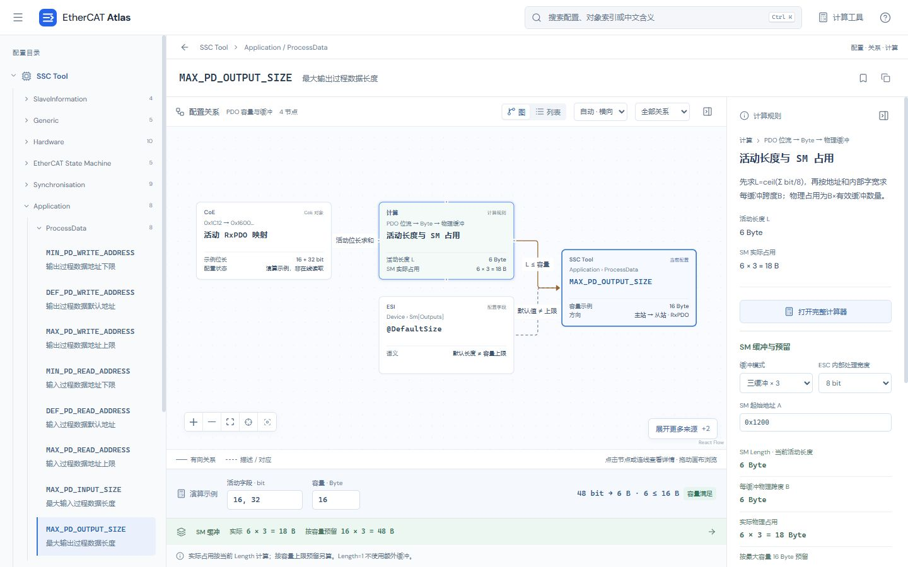
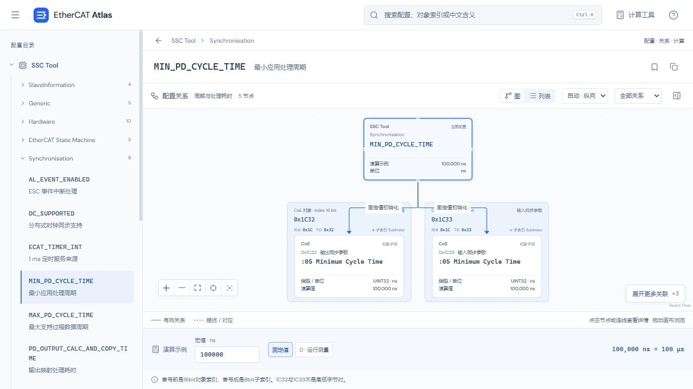
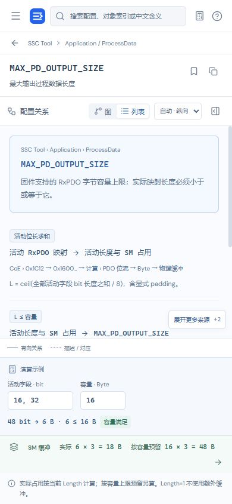

# 配置关系图改版：方案评估记录

日期：2026-10-24。任务类型：现状评估、UML建模与图式查阅实现。状态：v1.1本轮实现及检查完成，供用户再次审核；不代表用户已经认可布局。

依据：用户最新反馈（CoE端点不应混入配置列表；不接受整体布局、长文和独立关联列表；需要带父级上下文的节点连线图）。此前功能检查通过不代表这次产品模型与查阅体验已被用户接受。

## 本轮产物及验收

| 项目 | 标准 | 结果 |
|---|---|---|
| 根因 | 区分真实配置字段与CoE/寄存器端点，定位混层实现 | 已定位ssc.js identity数组与来源归组规则 |
| 实际流程 | 捕获目录、配置解释、关联页，截图与文字互相对应 | 已在内置浏览器完成并查看保存图片 |
| UML | 区分节点类型、来源位置、关系、规则和依据 | 已保存classDiagram与两个工程关系样例 |
| 语义 | 区分初始化/引用/推导/约束/前提；不强制三处一一对应 | 已在MIN_PD_CYCLE_TIME及MAX_PD_OUTPUT_SIZE样例中评估 |
| 案例 | 至少3个官方可核对案例，说明借鉴点与不适用点 | OpenMetadata、DBeaver、Node-RED；外部图片读取限制如实记录 |
| 改版边界 | 先评估再实现，保留阶段记录 | 评估阶段未改生产代码；后续v1.1实现、dist和交付ZIP已完成，结果见文末 |

## 改版前流程审查

1. **找配置（结构有问题）**：SSC目录本身可定位，但全部条目把CoE身份对象的索引直接当叶子名称，与宏配置并列。用户必须先理解对象索引和配置字段的差别。
2. **读配置（阅读负担偏高）**：MIN_PD_CYCLE_TIME的第一屏被目录、结果卡片、大标题、事实、定位表和重复说明占据。决定性信息是单位、固定/测量条件、对应CoE端点，却分散在不同区块。
3. **查关联（表达不足）**：单独关联页没有连线，只列4个文章链接；真正的0x1C32:05/0x1C33:05在事实文字中，没有可追踪的图端点。切换页签切断解释与关系的阅读上下文。

截图：

截图范围：当前816×608侧栏视口及1440×900桌面视口。以上评估针对信息架构、阅读与关系表达，不是全面WCAG审计；新图的键盘、屏幕阅读器、缩放与窄屏替代需在实现时检验。

## 实施验收标准（实施前确定）

- 主配置目录只显示真实配置字段；CoE对象/寄存器在图中按独立类型呈现。搜索地址可定位到有关配置及端点。
- 配置节点和目标节点均显示正确的父级位置；应用定义真实模板工作表/行号未经确认时不编造。
- 每条工程连线有明确类型、方向、条件和依据；同一对节点的不同关系不被错误合并；反向浏览查询原始边。
- 说明和关联合并到局部图视图。默认约4–8个相关节点、一跳深度；按需展开第二跳，能回到当前配置并适应视图。
- 右侧简短检查栏随选中节点/边变化；以一句作用、单位/范围、关键条件和一个短例子为主，长来源说明折叠。
- MIN_PD_CYCLE_TIME固定值与0测量模式正确；不误连ESI周期同值关系。
- MAX_PD_OUTPUT_SIZE体现活动映射长度计算、L≤容量约束；不把DefaultSize、实际Length和最大容量画成恒等。
- 公式带输入绑定、单位和适用条件；改变示例值后数字和相关节点/边状态一致。
- 图有可访问的文本关系替代、键盘节点选择、可见焦点、选中提示、缩放/定位恢复；小屏保持可读，不依赖缩小整张图。
- 两个样板的实际界面与业务规则验证通过后再迁移其余配置；此前旧URL保持可定位。

## 实施前补充：空间与方向

- 用户指出顶部标题/描述/搜索/来源区占用过大；改为单行紧凑工具栏，桌面主工具栏目标高度56px左右。全局搜索、当前位置和目录入口就近排列，移除重复大标题及条目总数展示。
- 目录直接展开至配置叶子，不再常驻第二列大型结果卡片。搜索、收藏、最近记录按需展开为紧凑结果面板。
- 桌面关系图默认左右分层，保持字段名正向可读；窄屏/窄画布采用上下分层。提供自动/横向/纵向选择，布局改变不改变关系语义。
- 不以缩小字体来塞下整张关系图；首次视图以可读缩放展示当前配置和直接关联，支持适应视图、聚焦当前项及缩放。检查器可收起，窄屏下移。
- 图节点、边、筛选、方向、展开与检查器选择均需真实交互；继承已有本地计算、搜索、收藏与深链接能力。

## 实施中补充：对象层级与缓冲模型

- 用户要求对象/字段的划分更明确：0x1C32:05是16bit对象索引与8bit子索引，不是两个字节拼接。同步参数对象容器与:05子项应分层显示；Inspector需说明Index内部高/低字节、SubIndex以及数值位段，不能把0x1C32与0x1C33解释成高低字节对。
- PDO容量要同时解释活动位流长度、容量上限、SM单缓冲Length、1/3缓冲和ESC内部字宽。演算应显示当前实际需求以及按最大容量预留的区别。经典8bit、L>1时三缓冲可为3L；宽内部字模型先向外取整，Length=1另有单缓冲例外。
- 每个正式配置项必须有明确模型分类和判断依据，不以统一文章模板或自由关系标签替代。字段映射、位域编码、功能前提、时序、地址范围、容量与缓冲等分类必须覆盖全部配置，未来新增配置缺少分类时检查应失败。

方案入口：[领域模型与页面结构](../architecture/configuration-graph-model.md)、[参考案例](../ui-prototype/graph-reference-cases.md)。

## v1.1 实施与验证结果

### 后续：PDI与过程数据看门狗（实施前标准，2026-10-24）

- 用户指出缺少0x0410；分别显示0x0400共享分频、0x0410 PDI/PDI0时间、0x0420过程数据时间。只保留宏到SM硬件状态/软件计时的选择关系，不画成宏直接启停PDI。
- 按Beckhoff Register Description V3.3 §2.10及Technology V2.5 §13，写明16bit寄存器、各自Count=0禁用、共享时基与独立触发。公式是40ns时基下的标称估算，有时基量化；不当作所有ESC精确波形。
- 新增适合初学者的时序图示：PDI访问与启用触发的SM写入分别刷新计时；支持持续、PDI停止、过程数据停止、两侧停止和观察时间变化，展示独立到期。本侧禁用不影响另一侧。
- 图示为ESC硬件教学，不宣称执行设备访问、代替SSC软件路径或实现物理安全动作。若支持第二PDI，PDI1参数另按芯片核对。
- 业务测试检查独立触发/到期/禁用及寄存器连线；真实界面检查0410可见、图/时序切换、拖动时间游标、四种情景、窄屏及生产日志。ESI研究作为独立评估结论交付，不擅自实施ESI改版。
- v1.2.2结果：0x0400、0410、0420分为三个节点，共享时基分别连接两个标称时间公式；宏只有两条SM路径选择边。9节点均位于初始可见范围，0410可实际读取与选择。
- 新增时序页默认展示常见PDI/PDI0及过程数据两条ESC硬件链路。四种情景实际操作：持续均刷新、PDI停访只PDI到期、主站写入中断只过程数据到期、两侧停止均到期。
- 键盘游标实际从150ms推进160ms，停止侧由等待变为名义到期；禁用PDI使Count=0并且不影响另一侧。计算器带入0，关闭后从关系图重新打开则回到图的1000示例，未串用旧演示参数。
- 1440×900、1280×720及390×844已实际观察。窄屏逐卡查看，轨道宽318px，页面与时序区无横向溢出；状态、最后触发、名义期限及观察线可读。生产error/warn为空。
- lint、81/81测试、build通过；无其他仓库修改和外部发布。图示不是采集波形，公式有时基量化范围，超时处理以硬件/固件实现为准。
- 截图：[双侧时序](../ui-prototype/watchdog-v1.2.2/timing-desktop.jpg)、[分频及两个计数器](../ui-prototype/watchdog-v1.2.2/relations.jpg)、[手机SM到期](../ui-prototype/watchdog-v1.2.2/timing-mobile-sm.jpg)。

### 数据与业务

- 103个正式配置均有显式模型类别和判断依据，配置新增缺少判断时测试失败。逐项清单见[配置模型判断清单](../architecture/config-model-inventory.md)；辅助概念与概览分别处理。
- 普通目录直接显示字段叶子。身份字段以Device name / Hardware version等命名，CoE地址留在对象/子项容器；同一Identity对象内4个子项不复制父对象。
- MIN_PD_CYCLE_TIME用0x1C32/0x1C33对象容器及:05子项分层；Index内部高低字节、独立SI和32bit数值位段分别显示。0测量路径与固定值初始化不同。
- 拷贝时间对应:06并支持0测量；物理Delay对应:09，0仍为固定描述值，不套用测量分支。相关上下限与处理耗时可继续展开。
- PDO位长16+32得到L=6Byte，容量16Byte。8bit内部模型实际6×3=18Byte，按容量预留16×3=48Byte。W32、A=0x1201时分别为8×3=24Byte和20×3=60Byte；切单缓冲后分别8Byte和20Byte。
- Length1有效缓冲数1，Length0不占空间；无活动映射且容量0可演算。容量5而L6时节点与约束标记不足，不显示成功。
- Mailbox按单缓冲预算；32bit映射、ControlByte位域、SDO权限、回调、对象结构、地址窗口等用对应模型；未确认的资料联系保持参考语义。
- 完整计算器实际带入SM2 Length6与A=0x1200、映射值0x70000110、ControlByte0x64。其他通道/范围明确为示例。

### 实际界面与交互

- 顶部品牌与搜索合并为56px顶栏；移除原大标题/说明/计数区及常驻大结果卡片列。目录可收起。
- 自动排列结合宽高及层数；横/纵向均实际切换。选择节点/连线、关系筛选、100%阅读、定位、展开来源、文字关系视图及检查器均可用。
- 修复对象容器被关系筛选误删的问题；所有筛选保留可见子项的祖先，新增回归测试。
- 对象索引搜索能找到相关配置；窄屏列表显示完整来源父级，避免同名:05无法分辨。输入搜索时保留当前图，只有一个搜索结果浮层。
- 配置/文件/回调/权限/地址/邮箱/映射/位域/身份等代表页均从实际应用进入，未见缺失节点或错误父引用。
- 原生计算器dialog实际打开及Esc关闭，初值承接当前图；页签与节点/边的Enter键选择实际验证。
- 尺寸覆盖1440×900、1280×720、768×1024、390×844。窄屏默认文字关系，图仍可选；页面无横向溢出，顶部不随内部滚动丢失，搜索浮层在390px边界内。修复中等画布工具栏被挤出、文字视图展开按钮遮挡内容的问题。
- 新建生产页v1.1.0的error/warn日志为空，所有资源本地加载；开发热更新的旧警告未计为生产结果。

### 工程检查

- npm run lint通过；npm test 50/50通过；npm run build通过，依赖分块后无大包警告。
- 构建与运行仅在本仓库，其他工具仓库未修改；本地地址4181，开发预览5182。
- 设备通信、实际SSC导入和具体ESC硬件联调不属于本次纯前端查阅与演算能力；未宣称执行硬件测量。

### 审核与交付

- 生产预览：[PDO容量与缓冲](http://127.0.0.1:4181/#/entry/max-pd-output-size)、[同步对象与子索引](http://127.0.0.1:4181/#/entry/min-pd-cycle-time)。
- 版本1.1.0；本地交付包为`artifacts/ethercat-atlas-v1.1.0.zip`，包含静态站点及启动脚本，未发布到外部站点。
- ZIP SHA256：`4F40F00737BCFCE1DD40E220355D285C02CBD9C8705C43CF958E32705833398A`。
- 以下为真实生产界面截图。移动端使用文字关系替代以保持字段和父级可读；平板工具栏修复另外通过实际边界测量验证。

