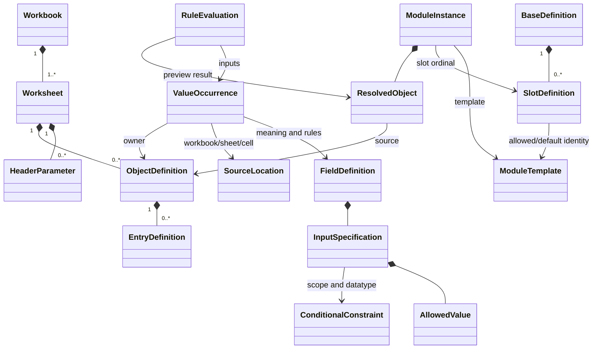

# 应用定义：工作表来源与领域模型

日期：2026-10-24。用户批准 C 方案后实现于 v1.2.0。具体项目的启动应用按后续反馈移除，运行包包含普通单体、模块化单实例、模块化双实例三个通用示例。

## 核心结构



原始快照保持实际字段值、空白与行号。列说明是 FieldDefinition，当前对象或成员中的一次取值是 ValueOccurrence。字段含义结合工作表角色、行类型、对象索引判断，不靠固定的单元格地址判断。

FieldDefinition同时拥有输入规范：枚举/语法、类型范围、空白语义、适用对象、组合写法和依据。页面可投影成表格、字段说明或填写手册，不把某一个示例取值当作全部支持范围。

## 已实现的界面与模块

- `src/data/application-basic-example.js`：普通单体及单模块 Slot 教学定义，明确为示意位置，没有对应的真实项目文件。
- `src/data/application-workbooks.js`：聚合通用示例；模块化双实例仍采用 Base_Device、Digital_Input、Digital_Output 原模板只读快照。不包括具体项目文件或绝对本机路径。
- `src/data/application-field-specs.js`：15 列及表头的填写规范，记录枚举、语法、范围、空白语义、适用层级、例子、版本与章节。DataType 34 种类型/语法形式，Access 13 个基础与状态相关权限；不是单个当前值的摘要。
- `src/components/ApplicationFieldGuide.jsx`：列标题直接打开填写手册；支持逐列导航、写法检索、范例复制及回到表格。单元格说明包含常用写法摘要。
- `src/lib/application-model.js`：对象与成员归组、表头元数据、生成项预览、槽位注解、Module Ident 解析、按条件展开、局部关系及来源定位。
- `src/components/ApplicationDefinition.jsx`：工作表导航、对象表格、上下文说明、槽位页、关系弹窗。图只在用户选择关联时出现，表格始终是主入口。
- APP 的旧字段 ID 与来源资料保留；全局搜索可进入对应字段语境。路由新增 workbook、sheet、row、field、appPane，浏览器返回与刷新恢复来源位置。

```text
只读示例数据 ──> 领域解析 ──> 字段语义 / 规则预览
                     │                 │
                     └── 对象表格 <──> 上下文说明 / 局部关系图
```

## 关键判断与边界

1. 基础表 C3 是 IndexIncrement；模块表 C3 是 Module Ident，模块步长设置位于 C4/C5。按字段名检索。
2. 空白是未填写；不会填成 0。成员行空白 Index 的归属来自对象头行，来源仍分别标注原始空单元格与所属头行。
3. VARIABLE 的 :00 是值；RECORD/ARRAY 的 :00 使用生成规则预览行，不伪造原表行号。复合对象头 Access 与成员权限独立。
4. F030 Description 的 Slotname/ModuleIds 是结构注解；Default Value 是默认模块选择，二者分开解析。模块身份不得用工作表名称替代。
5. 示例使用 F030 子索引减一作为零基槽位序号，基础表步长计算 0x6000/0x7010 等预览。模块表增量设置控制 DependOnSlot，实际步长来自基础表。生成产物及固件实例化仍需独立核对。
6. 源表没有显式 PDO Mapping/Assignment，因此 rx/tx 仅表示可映射能力，不编造实际 PDO 索引、活动长度或下载配置。对象步长与 PDO 步长分别展示。
7. 输入范围、回调、标志等旧资料保留为字段知识；本实现不是任意 XLSX 文件解析器，不改写工作簿，不执行设备操作。
8. 对象/成员是统一核心；模块模板与槽位是可选层。普通应用不显示槽位页；模块化只有1个实例仍然使用模块/槽位模型，不按工作表数量或实例数量分类。

参考：用户提供的内部资料（私人出处仅在本地留档）、[ET9300 V1.10 §6.4.1/13.4](https://download.beckhoff.com/download/Document/io/ethercat-development-products/an_et9300_v1i10.pdf)。布局采用此前研究的 DBeaver 表格/侧栏方式，领域对象保留 Index、SubIndex、模块与槽位关系。

验收：[应用工作台记录](../acceptance/application-workbook-redesign.md)。

## v1.2.1：零增量与SSC本地对象边界

普通模板同样保留IndexIncrement与PdoIndexIncrement，示例C3/C4为显式0。它们是否出现不能用作模块化分类条件；空白与0区分，基础表/模块表的语义继续分别判断。

DataType填写手册增加“SSC对象边界”视图，并从字段说明直接进入。按ET9300 V1.10 §7.1展示≤8bit不跨字节、从WORD起点开始的完整16bit小成员块、>8bit按WORD偏移开始。五组示例有原排布和显式填充的独立对照；图不修改源表，不自动扩展PDO。

`ssc-object-layout.js`检查每个连续小成员组，而非只检查整个对象的总长。它以给定成员序列从WORD边界开始为前提，不推断编译器填充；SI0本地分配按§7.2另核对。局部对象条目BitLength按§7.3的UINT16范围处理，与PDO映射条目8bit位长限制分开。原PDO位流计算仍保持连续偏移。
