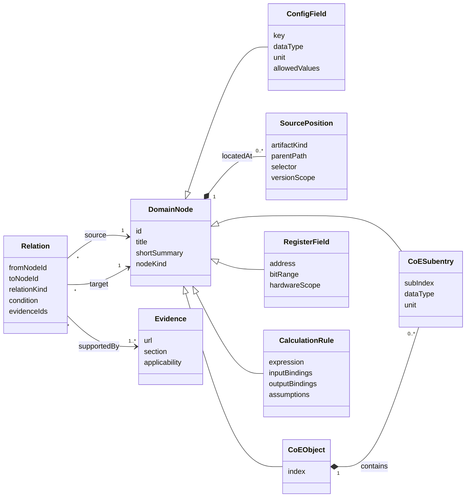
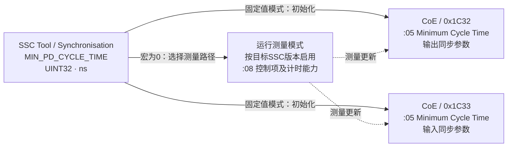
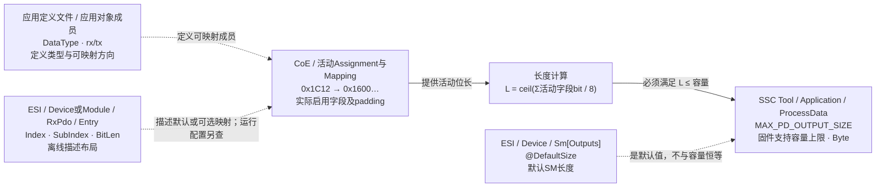

# 配置关系模型与图式查阅方案

日期：2026-10-24。阶段：方案已实施为v1.1图式查阅。本文件保留设计判断；实际模块见frontend.md，逐项分类见config-model-inventory.md。

## 用户问题与本轮结论

用户不接受当前长文档式页面及独立的关联列表。主任务是查真实配置的用途、关联端点、在其他文件中的位置和计算依据。建议以“当前配置的局部关系图 + 简短检查栏”为主要视图，实体目录保留 SSC Tool、应用定义文件（Excel）与 ESI 设备描述文件。

CoE 对象、ESC 寄存器不是普通配置列表条目。它们作为配置相关的图端点存在；搜索索引地址时可定位相关配置和高亮端点。SlaveInformation 中确实可配置的设备名称、硬件版本、厂商身份等，应使用真实字段名称作为导航标签，将相应 CoE 地址附在关系图中，不能为了移除索引而另造宏名。

## 现状模型问题

1. `src/data/ssc.js` 中 identity 数组直接以 0x1008、0x1009、0x100A、0x1018 为 Entry 名称，并拼入 sscEntries；导航按数组来源整体归为 SSC。当前索引混入是模型混层，不能只修排序。
2. 同一 Entry 结构承担配置字段、协议对象、概念文章和概览。`sources` 同时承担“配置位置”和“关联资料”两种含义。
3. 本轮快照共有125条Entry、342条relations，关系type有84种自由文本。导航词（起点/返回/查阅）、解释提示（区别于/澄清）、工程关系（初始化/约束/引用）混在一起。
4. MIN_PD_CYCLE_TIME 的 CoE 端点藏在 facts/details 中，没有作为关系对象建模；当前关联页因而不能显示真正有用的 0x1C32:05 / 0x1C33:05 链路。
5. 反向关系通过文字变换产生，且按已存在目标去重，可能丢失同两节点之间不同性质的联系。图应保存一条有来源的真实关系，查询其入边/出边，不制造新事实。

## UML 领域模型



DomainNode 是图中实体；只有 ConfigField 进入对应工具/文件的普通配置目录。SourcePosition 是节点的上下文和定位资料，不需要每次画成独立节点。概念解释作为可展开帮助，不与配置并列为同一种叶子。

### 连线契约

| kind | 用户可见标签示例 | 含义与方向 |
|---|---|---|
| initializes | 初始化 | 源值初始化目标；须记录固定值/测量模式等条件 |
| generates | 生成 | 工具/模板字段参与生成描述或代码；不代表在线状态 |
| references | 引用 | 一个对象条目指向另一对象的索引/子索引 |
| encodes | 编码 | Index/SubIndex/BitLen 与32bit映射值之间的编码 |
| derives | 计算得到 | 输入经明确公式得到结果；显示单位和假设 |
| constrains | 不得超过/必须满足 | 容量、范围、对齐等约束，不能解释为相等 |
| requires | 启用前提 | 功能或模式的先决条件 |
| describes | 描述 | 离线描述与固件能力的关系；不宣称已生效 |

“对应”必须说明究竟是同值、同一对象地址、生成关系还是一致性约束。无法明确语义的旧关系保留为待整理内容，不直接升级为因果箭头。关系的条件、单位、适用版本和证据属于关系本身。

## 例一：最小应用周期



短说明建议：**声明最小应用处理周期，单位ns；固定值初始化同步参数对象，0走测量路径。** 例：100000 ns = 100 µs。0不是零耗时，也不是设置主站周期的命令。

本项没有必然一一对应的Excel列或ESI DC周期字段。不能为了图形对称而添加“MIN_PD_CYCLE_TIME = CycleTimeSync0”的连线。完整应用处理包含输出映射、应用处理和输入映射，不能仅将两个拷贝时间宏相加当作最小周期。

## 例二：最大输出过程数据容量



16+32 bit 的活动映射得到 L=6 Byte；容量宏设为16 Byte也可以合法，不能把二者画成恒等。ESI DefaultSize、实际SM Length、固件容量上限分别保留。三缓冲占用根据当前Length、地址和ESC内部字宽推导，不直接写成固定3×容量上限。

本例中应用定义与ESI描述的生成/匹配关系必须核对具体对象、模块和profile；文件行号/工作表名未知时显示“待绑定实际模板位置”，不编造。

技术依据：[Beckhoff ET9300 V1.10](https://download.beckhoff.com/download/document/io/ethercat-development-products/an_et9300_v1i10.pdf) §9.2、§13.3、§16.1；另参考项目既有技术复核中的SM内存模型。图中的箭头是经过条件限定的工程含义，不是全部EtherCAT设备的固定生成流水线。

## 节点内容规则

每个节点默认只显示：来源类型、父级路径、字段/索引名称、一个关键类型/单位/示例值。父级直接放在节点头部，例如：

- `SSC Tool › Synchronisation` / `MIN_PD_CYCLE_TIME` / `ns`。
- `CoE › 0x1C32 输出同步参数` / `:05 Minimum Cycle Time` / `UINT32 · ns`。
- `ESI › Device › Sm[Outputs]` / `@StartAddress` / `ESC地址`。
- `应用定义文件 › 实际工作表 › 成员行` / `DataType`、`rx/tx`。工作表和行号要在实际模板绑定后显示。

同一ESI元素或Excel成员的多个相关字段可以合并为一张容器卡片，连线落在具体字段行。其他无关字段折叠，不把整个文件当作一个巨大节点。

## 建议页面结构

```text
+----------------------+----------------------------------------------+--------------------+
| 实体/分组/配置叶子树  | 当前配置路径 + 全局搜索 + 关系类型筛选       | 当前选择           |
|                      +----------------------------------------------+ 一句话作用         |
| SSC Tool             |                                              | 类型 / 单位 / 范围 |
|  Synchronisation     |          局部配置关系图                      | 关键条件 1–3 条    |
|   MIN_PD_CYCLE_TIME   |    来源父级在卡片内，线带明确标签            | 一个短例子         |
| 应用定义文件         |                                              | 来源与版本可展开   |
| ESI设备描述文件      |    节点：选择并展开相关项                     |                    |
|                      |    连线：选择查看关系/条件/公式               |                    |
+----------------------+----------------------------------------------+--------------------+
| 存在计算关系时显示：输入 → 公式 → 代入 → 结果/约束检查；可收起                         |
+------------------------------------------------------------------------------------+
```

减少重复的中间大卡片列表与大标题。左侧可以直接从组展开到配置叶子；搜索结果以紧凑可收起面板出现。说明和关联合并为同一任务界面。选节点查看该节点，选连线查看该关系；选中切换与图中高亮必须一致。

初始仅显示当前配置一跳、约4–8个有用节点；按需展开第二跳。支持适应视图、缩放、定位当前配置、回退到上一配置。缩放不应成为阅读文字的唯一方法；关系同时提供可读的线性列表以支持键盘/小屏。

## 评估与实施顺序

- 图式方案最适合“配置在哪里、连到什么、怎么计算”三类问题；枚举定义、复杂前提和异常处理仍用短表/展开说明补充。
- 不采用全库总关系网作为首页；当前自由文本关系直接上图会制造噪声甚至错误因果。
- 先手工建好两个有技术依据的样板：MIN_PD_CYCLE_TIME（固定/测量分支）、MAX_PD_OUTPUT_SIZE（布局计算和容量约束）。两者验证模型能表达不同语义，而非仅做同一种漂亮卡片。
- 样板评审通过后再迁移全部数据；身份字段与CoE对象拆分，旧URL保留重定向/定位。
- 维护来源路径、技术边类型、短说明和计算规则的单一结构化数据；不要再分别维护两份解释相同关系的长文和自由标签。

## 已实现的关键区分

- CoE对象是16bit Index，子项由独立8bit SubIndex定位；对象容器包住子项，检查器额外展示Index内部高低字节与适用的数值位段。
- PDO容量演算同时显示实际L、按内部字宽取整的单缓冲跨度B、有效缓冲数N、实际B×N和按容量上限预留。三倍只在对应模式/长度条件下成立；Mailbox单缓冲、Length0停用、Length1额外缓冲不使用分别呈现。
- 103个正式配置逐项绑定模型类别与判断依据；文件引用、回调、对象结构、权限、编码、状态、地址、时序与容量等有不同关系结构。未明确成因果的旧资料关系仍为参考虚线，不自动成为公式。
- 完整计算器承接当前图的相关初值。窄屏提供默认文字关系视图，保留父级路径和图切换；宽屏图形可自动或手动横向/纵向排列。
