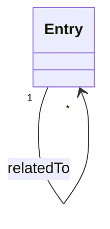
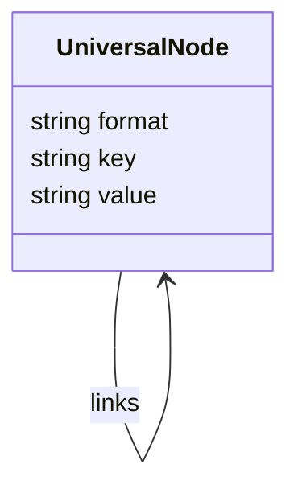
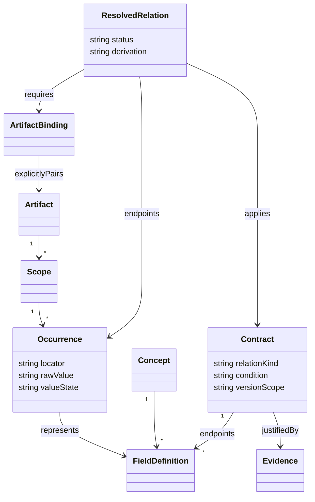

# 跨来源查阅模型评估

## 结论

保留 SSC 配置树、应用工作表、ESI XML 树；重构跨来源的知识关系层。三者是不同载体，不应合并为一张扁平配置表。统一的是工程概念、规则、来源定位与关联查询。

现状有三套关系构造：`config-graph` 的条目/计算节点、`application-model` 的单元格/对象/槽位、`esi-model` 的 XML 包含/引用。ESI 检查器另从条目的 relations 拼接相关文章。它们缺少一致的关系契约，扩展时容易只连到文章、漏反向或错误地宣称同值。

另一个事实：内置 `Teaching_IO.xml` 的 0x7000 是 UINT 变量；应用单体示例的 0x7000 是带 BOOL 成员的 RECORD。它们是独立教学文件，不是已核对的生成链。不能按相同 Index 自动匹配。

## 三版 UML

### A：条目之间直接加链接



改动小，但无法表达字段位置、生成条件、计算及证据，反向链接容易漂移。不作为核心模型。

### B：把所有格式展开为一个通用节点表



树与图绘制简单，但工作表的对象继承、XML 作用域、Module 模板/实例及语义类型都变成无约束字符串。界面会出现大量低价值节点，不推荐。

### C：来源适配器 + 概念/字段规则 + 实例来源（采用）



第一步落地 FieldDefinition/Contract/Evidence 的公共注册表和双向查询，三个界面共用；现有 XML/工作表模型作为 Occurrence 的适配器。当前文件位置明确展示，但未绑定同工程文件时，不生成 ResolvedRelation。

ArtifactBinding 是将来做真实工程文件比对时的显式配对，不在本轮虚构为已经存在的功能。名字、Index、ProfileNo 相同不足以构成配对证据。

## 关系契约

| 类型 | 含义 | 必须保留的条件 |
|---|---|---|
| generate | SSC/应用定义参与生成 ESI 描述 | 同一工程、SSC版本、生成分支 |
| initialize | 固定宏初始化 CoE 项 | 具体 SI、单位、固定/测量分支 |
| reference | PDO Entry 指向对象成员 | Device/Module、Index + SI、模板/实例 |
| constrain | 活动数据长度不超容量 | 已确认活动分配、方向和单位 |
| derive | 类型/步长/位长参与计算 | 公式、单位、条件、异常结果 |
| describe | 同一概念的不同描述 | 不宣称原文字符串或实例值相等 |

```text
SSC adapter ───┐
APP adapter ───┼── 选中来源位置 ── 公共概念/规则索引 ── 局部图 / 对应表
ESI adapter ───┘                         │
                                 来源、版本、条件、跳转

ESI 内部引用 ── 当前 Device/Module 的实际解析（独立保留）
跨文件规则 ─── 未绑定工程时只解释生成/约束，不冒充实例匹配
```

## 案例选择

| 案例 | 可借鉴内容 | 本工具取舍 |
|---|---|---|
| [esd EtherCAT Workbench](https://esd.eu/fileadmin/esd/docs/manuals/en/EtherCAT_Workbench_Manual_en_20.pdf) | ESI、CoE字典、模块与槽位上下文；区分离线描述与在线字典 | 最贴近领域组织方式；不引入通信功能 |
| [CANopenEditor](https://github.com/CANopenNode/CANopenEditor) | 对象字典核心支持 EDS/XDD、文档、C 等产物 | 参考统一语义核心与格式适配；CANopen 字段不能直接当 EtherCAT ESI 规则 |
| [KiCad cross-probing](https://docs.kicad.org/master/en/pcbnew/pcbnew.html#cross-probing-from-the-schematic) | 从一个表示定位另一表示，同一对象多视图 | 参考点击节点定位来源、保留选中上下文；实例绑定必须明确 |
| [Langium](https://langium.org/docs/reference/document-lifecycle/) | AST、符号索引、作用域、链接、验证分阶段 | 参考模型分层与未解析状态；当前规模不引入语言服务器或后端 |

这些参考分别解决领域组织、语义复用、跨视图定位和引用解析，没有一个项目可以原样替代全部需求。
