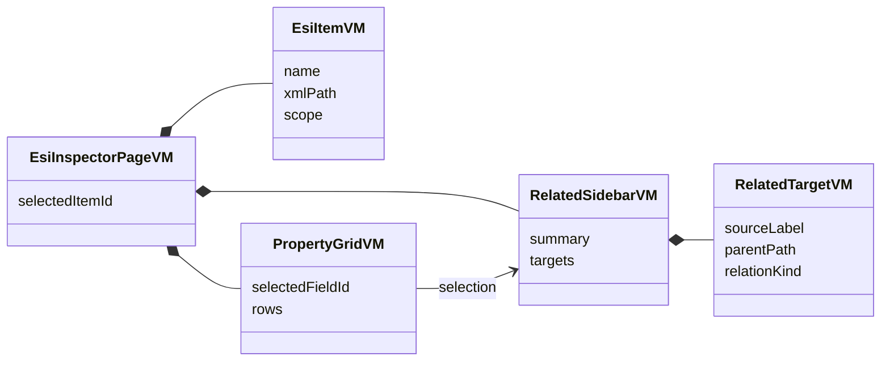
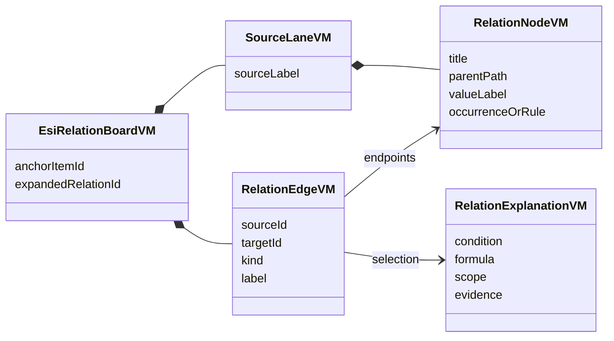
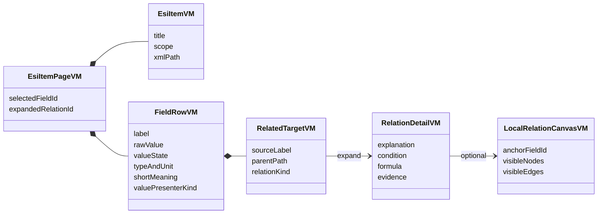

# ESI 显示重构：三种展示模型与案例评估

日期：2026-10-25。范围是 ESI 页面如何展示自身内容及其与 SSC Tool、应用对象字典定义的关联。下面的 UML 是界面展示模型，不是数据库、解析器或工程配对架构。

## 推荐结论

以方案 C「条目工作页 + 字段内关联」作为默认显示；需要解释链路和计算时，在当前条目内展开方案 B 的局部关系图。方案 A 保留作窄范围快速查看的思路，不常驻第三栏。

ESI 是页面主体。SSC Tool、应用定义作为当前 ESI 字段的对应来源或约束出现，不设置三个独立大页面让读者来回寻找。没有直接关系的来源不强行填满。

## 当前界面的具体问题

- 同一 ESI 内容分在结构、字典、PDO、Profile、XML引用、跨文件对应、XML原文等页签，读者需要自己维持选中上下文。
- XML 元素表以标签名与原文为主，字段用途、写法和对应项需要另外打开。
- 常驻说明栏压缩了表格和关系图；说明和跨文件工作台又各有标题、位置、状态与来源，形成重复。
- 目前跨文件图主要显示字段规则；图中的定义不能被误读为当前工程已经匹配的实例。

## 共同的显示数据

每一个 ESI 条目页应回答：在哪里、是什么、怎么写、与谁关联、为什么关联、怎么算。

| 展示对象 | 必须显示的数据 | 显示方式 |
|---|---|---|
| ESI上下文 | 文件、Device/Revision、Device本体或Module模板、Profile | 单行上下文；版本和原文路径可展开 |
| 当前条目 | 语义名称、XML名称、当前值、简短用途 | 紧凑标题与一行摘要 |
| 字段行 | 字段名、原文值、类型/单位、用途、关联入口 | 表格；明确0、false、缺失、未知 |
| 关联目标 | SSC/应用/ESI/ESC来源、父级路径、目标字段 | 节点或展开行；目标可定位 |
| 关联解释 | 类型、方向、条件、公式、适用范围、出处 | 选中连线/对应行后按需显示 |
| 关系状态 | 当前文件解析的引用 / 文档规则对应 / 计算预览 / 未解析 | 标签配合线型，不能只靠颜色 |

`valuePresenterKind` 控制值本身的显示：普通值、位段、Index/SubIndex、位布局、容量公式、时序。它只是展示选择器；不能因为都是 XML 字段就统一画成普通字符串卡片。

## 方案 A：ESI 树 + 属性表 + 右侧关联栏

```text
┌ 文件 / Device / Revision ─────────────────────────────┐
│ ESI导航 │ 当前项属性表              │ 说明与关联       │
│         │ 字段 | 值 | 类型          │ SSC Tool        │
│         │                          │ 应用定义        │
│         │                          │ 条件与来源      │
└─────────┴──────────────────────────┴──────────────────┘
```



优点：常见专业工具布局，选字段立即有短说明；简单一对一对应查得快。

问题：三列一起存在时主区变窄。涉及多个对象、公式或中间步骤时，右栏又会变成长文章。与用户已经不满意的布局有相同风险。

适用：身份字段、单个属性快速说明。不建议成为整个 ESI 的固定布局。

## 方案 B：以当前 ESI 项为锚点的三来源局部关系台

```text
┌ ESI导航 ┬ 当前项：RxPdo / Entry ─────────────────────┐
│         │  应用定义       当前 ESI        SSC Tool   │
│         │  E列 DataType → BitLen → 长度计算 → 容量   │
│         │  M列 rx/tx  ──→ RxPdo ───────→ SM约束    │
│         ├───────────────────────────────────────────┤
│         │ 所选连线：关系类型 / 条件 / 公式 / 来源    │
└─────────┴───────────────────────────────────────────┘
```



优点：最适合解释生成关系、索引展开、容量计算、中间条件；节点带父级路径，连线有明确语义。

问题：查一个简单值也要读整张图；字段多时很容易变成关系网，缩放后文字太小。不是每个 ESI 字段都有三个来源。

适用：在条目中按需展开复杂链路。只展示当前字段的一到两跳；缺省不加载全部关系。

图示规则：

- 水平空间足够时按信息流横向；存在分支或中间计算时折行，避免长链无限缩小。
- 窄屏转为有顺序的对应表/步骤，不强行缩图。
- Index步长、PDO步长、字节/位换算应有独立的规则或计算节点。
- 允许只有 SSC 对应，或只有应用对应；不为凑三列添加无关节点。

## 方案 C：ESI 条目工作页 + 字段内关联（默认推荐）

```text
┌ 文件 / Device / Revision ────────────────────────────────┐
│ ESI导航 │ RxPDO · Outputs · 0x1600                       │
│         │ XML路径 / 方向 / 简短用途                      │
│         ├───────────────────────────────────────────────┤
│         │ 字段       原文值      含义           对应     │
│         │ Index      #x7000      映射对象       应用定义 │
│         │ SubIndex   0           对象成员       应用定义 │
│         │ DataType   UINT        协议类型       应用定义 │
│         │ BitLen     16          本项位宽       规则 2   │
│         ├───────────────────────────────────────────────┤
│         │ BitLen 的对应：                               │
│         │ 应用 E列 → 协议位宽；选入活动PDO后参与长度计算 │
│         │ [展开局部关系图] [定位来源] [XML原文]          │
└─────────┴───────────────────────────────────────────────┘
```



优点：读者先看到 ESI 自身的值和用途，对应来源就在字段旁；展开关系时保留原位置。属性多时仍可筛选和扫描，适合查阅工具。

代价：需要按 ESI 条目类型组织字段。Object、PDO、Sm、Slots、Dc 不能全部套同一张通用标签表。

落地方式：主区只有当前条目。原文、来源规则和关系图按需展开；关联不再作为全局大页签。右侧栏不常驻。

### 推荐导航

```text
ESI 设备描述
├ 身份与识别
├ 通信配置
│ ├ SyncManager
│ ├ Mailbox / CoE
│ └ DC 同步
├ 对象字典
│ ├ Objects
│ └ DataTypes
├ 过程数据 PDO
│ ├ RxPDO
│ └ TxPDO
├ 模块 / 轴
└ SII / EEPROM

[XML树] 是可切换的原始结构视图，未知元素始终可访问。
```

### 不同 ESI 条目的主内容

| 类型 | 主显示 | 关联显示 |
|---|---|---|
| 身份 | Vendor/Type各字段、修订、所属Device | SSC SlaveInformation；有规则才显示对象身份对应 |
| Sm | 地址、长度、方向、ControlByte位段 | SSC地址/容量/看门狗；内存规则按需展开 |
| PDO | PDO→Entry成员表、方向、Flags、位偏移 | 应用列、对象引用、Assignment/SM、容量条件 |
| Object/DataType | 对象头+成员、类型、权限、布局 | 应用对象/成员字段及类型转换，区分BitOffs与PDO偏移 |
| Slots/Modules | 允许类型、默认选择、模板/实例、步长 | 应用基础/模块表头，条件公式作为中间节点 |
| Dc | 同步方式、激活位、周期与相位 | SSC能力/时间参数；不把最小周期当SYNC0周期 |
| Profile402 | 控制/状态字、驱动模式、明确的轴分组 | 402逻辑状态与PDO；不推断每个6xxx都是输入 |

## 任务导向比较（设计判断，不是用户实验分数）

| 查阅任务 | A固定右栏 | B关系台为主 | C条目页+按需关系 |
|---|---|---|---|
| 查某字段是什么、怎么写 | 快 | 需要先理解图 | 快 |
| 看 SSC 与应用对应 | 可看简单列表 | 清楚 | 字段旁可见，展开后清楚 |
| 看多步计算/条件 | 容易长文 | 最强 | 展开B即可 |
| 扫描多字段/批量比较 | 主表受挤压 | 较弱 | 最强 |
| 保持当前ESI位置 | 可以 | 易跳到其他节点 | 最明确 |
| 小屏可读性 | 需要面板切换 | 需转列表 | 易顺序展开 |

## 三个用例验证

1. **PDO Entry / BitLen**：先显示16 bit及用途；关联应用DataType的协议位宽。只有确认活动映射后，才进入 `L=ceil(Σbit/8)` 与 SSC `MAX_PD_OUTPUT_SIZE` 的容量约束。候选PDO总和不冒充活动长度。
2. **Slots / SlotIndexIncrement**：先显示对象步长与PDO步长两行。展开时分别展示对象/Entry用IndexIncrement、PDO用PdoIndexIncrement，模板到实例的公式在中间。普通单体的0增量保留为显式0。
3. **Sm / ControlByte**：先显示原字节和位段，bit6解释看门狗触发；关联SSC处理宏与ESC计时。没有应用字典直接对应时，不构造一条虚假的应用连线。

## 互联网案例调查

检索覆盖从站设计工具、网络配置工具、开源字典/ESI查看器及跨视图定位。以下仅以公开厂商文档或项目仓库支持功能事实；适合本工具的取舍是本次设计判断。

| 案例 | 已核实事实/可借鉴点 | 边界 |
|---|---|---|
| [port EtherCAT Design Tool](https://www.port.de/en/products/ethercat/tools/ethercat-design-tool.html) | 以设备数据库组织对象字典、ESI、配置代码和文档；参数树及按对象说明 | 与跨载体配置解释最接近；使用其自身协议栈，不能把生成规则照搬为SSC规则 |
| [EC-Engineer 4.1 界面](https://public.acontis.com/manuals/EC-Engineer/4.1/html/Common/gui.html) / [PDO及模块](https://public.acontis.com/manuals/EC-Engineer/4.1/html/EC-Engineer/config-mode.html#pdo-mapping) | Project Explorer、Device Editor、Short Info分工；PDO/Entry表、Slot与Module并列定位 | 是网络配置/诊断工具；本工具只借鉴语义导航与局部详情，不显示扫描/写入操作 |
| [esd EtherCAT Workbench](https://esd.eu/fileadmin/esd/docs/manuals/en/EtherCAT_Workbench_Manual_en_20.pdf#page=49) | 可在槽位及匹配模块之间查阅；区分模块、逻辑功能、字典与过程数据 | 借鉴模块页，不照搬密集页签和整套网络工具栏 |
| [CANopenEditor](https://github.com/CANopenNode/CANopenEditor) | 对象字典是核心，可输出EDS/XDD、文档及C；公开仓库可研究实现 | 借鉴对象/成员/权限与PDO的组织；CANopen XDD不等于EtherCAT ESI |
| [KiCad cross-probing](https://docs.kicad.org/master/en/pcbnew/pcbnew.html#cross-probing-from-the-schematic) | 在一个表示选中对象，定位另一个表示中的对应项 | 借鉴定位、高亮、返回原位置；不是EtherCAT字段规则来源 |
| [OpenESI](https://github.com/naveen-kumar-singh/OpenESI) / [在线查看器](https://naveen-kumar-singh.github.io/OpenESI/) | 浏览器读取ESI，显示设备、SM、PDO和字典 | 适合快速总览；不能替代SSC/应用关联。源码的全局选择器和首Device假设不适合作为多Device模型 |
| [RT-Labs Slave Editor](https://rt-labs.com/product/ethercat-slave-editor-commercial-license/) | 公告明确涉及SSC spreadsheet导入、访问限制、SM和MAX PDO计算 | 文档需要客户登录，未核实完整界面，不将其作为已完成的视觉对标 |
| [Synapticon OBLAC EDT](https://oblac-edt.synapticon.com/) | 公开入口说明ESI编辑、源代码/文档生成 | 当前公开抓取仅有加载壳，未验证详细页面，不据此推断布局 |

没有发现可直接照搬的“SSC Tool + 应用定义 + ESI跨来源查阅”完整模板。最有价值的组合是：port 的多产物语义组织、EC-Engineer/Workbench 的领域导航、KiCad 的跨位置定位。

## 评审交付范围

本文件记录评审阶段的三份展示UML、布局对照、用例及案例依据。用户随后批准方案C+局部B，已在v1.4.0实施，见 `docs/acceptance/esi-item-display.md`；解析、源文件及计算模型沿用既有实现。
